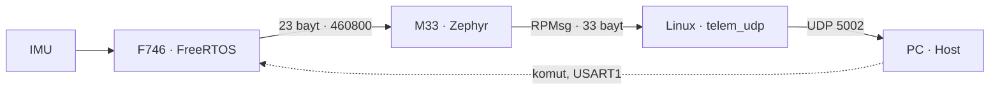

---
tags:
  - genel
---

# Başlangıç

Bu kasa, F746 → MP257 → PC telemetri sisteminin notlarıdır. [[Sistem]] notundan başla.

## Bölümler

**00 Genel**
[[Sistem]] · [[Yol haritası]]

**01 Kararlar**
[[Bekleme yok kuralı]] · [[Her kayıp sayılır]] · [[3 saniyelik süre]]

**02 Donanım**
[[IMU]] · [[F746]] · [[MP257]] · [[Kablo]] · [[USART6 hattı]] · [[SRAM2]] · [[Paylaşılan bellek]] · [[IPCC]] · [[USB ağı]]

**03 F746**
[[FreeRTOS]] · [[DRDY kesmesi]] · [[meas task]] · [[CAL mailbox]] · [[Açı filtresi]] · [[raw_link]] · [[PC yolu (USART1)]] · [[IP task]] · [[uartTx]] · [[TX kuyruğu]] · [[vnetRx]] · [[critParser]] · [[ctrlTask]] · [[EventGroup]] · [[Havuz]] · [[Muhasebe]]

**04 Paket**
[[Ham mesaj]] · [[TELEM paketi]] · [[SEQ]] · [[CRC-8]] · [[Sessizlik çerçevesi]]

**05 Zephyr**
[[M33]] · [[uart_isr]] · [[k_msgq]] · [[main thread]] · [[packet.c]] · [[rpmsg_link.c]] · [[link_task]] · [[link_send]] · [[ipcc.c]] · [[k_sem]] · [[k_timer]]

**06 Linux**
[[RPMsg]] · [[vring]] · [[Resource table]] · [[remoteproc]] · [[Linux A35]] · [[telem_udp]]

**07 Host**
[[Host]] · [[Host GUI]]

**08 Ölçümler**
[[Ölçüm - F746|Ölçüm: F746]] · [[Ölçüm - M33|Ölçüm: M33]] · [[Ölçüm - PC|Ölçüm: PC]]

**09 Testler**
[[T01–T08]] · [[Test M4]] · [[Test M5]] · [[Test M6]] · [[Test M7]] · [[QEMU testleri]]

**10 Hatalar**
[[Hata - UART taşması|Hata: UART taşması]] · [[Hata - overlay sessizce uygulanmadı|Hata: overlay sessizce uygulanmadı]] · [[Hata - yanlış remoteproc|Hata: yanlış remoteproc]] · [[Hata - DDR yavaşlığı|Hata: DDR yavaşlığı]] · [[Hata - CRC8_POLY|Hata: CRC8_POLY]] · [[Hata - QEMU saati|Hata: QEMU saati]] · [[Hata - OpenAMP beklemeleri|Hata: OpenAMP beklemeleri]] · [[Hata - sınırsız kuyruk|Hata: sınırsız kuyruk]] · [[Hata - TLS hizası|Hata: TLS hizası]] · [[Hata - kaba saat|Hata: kaba saat]]

## Zincirdeki süreler

| Süre | Ortalama |
|---|---|
| F746, DRDY → son bit | 596,2 µs |
| M33, T3−T2 | 3,0 µs |
| M33, T4−T3 | 8,2 µs |
| M33, T5−T4 | 7,6 µs |

Ayrıntı: [[Ölçüm - F746|Ölçüm: F746]], [[Ölçüm - M33|Ölçüm: M33]], [[Ölçüm - PC|Ölçüm: PC]]

Animasyonlu rapor: `Rapor/Sistem_Raporu.html` (kasanın dışında).
